# Stimpy Calendar and Ads

Launch: **Saturday, November 14, 2026**. Ads: **November 12 to December 8, 2026** ($450 ceiling, $448 planned), using only the five filmed videos, as they are.

All times are Beirut time. They are starting points; adjust them after two weeks of Instagram Insights.

Dated post files below are in `C:\Projects\motion\content\calendar\posts\`, unless a full path is shown.

Each preview shows frames from the start, middle and end of the video, or the poster or carousel slides. Click a preview to open the file. Preview images are in `_previews\`.

## Must happen first

**Updated Nov 11:** the ads now run only the five filmed videos, uploaded as they are (see "Ads"). Nothing is re-cut or re-exported for the ads, so the old Arabic Video 4 shoot, the Ad 1 "14.11" ending and the Ad 3 re-cut are no longer needed.

| By | Task | Rule |
|---|---|---|
| Done | Rights for SABOTAGE and NEON | Owner confirms they hold the rights. Both designs stay |
| Nov 9 | Confirm live price, delivery fee and who pays it, refusal cost, exchange policy and stock | Write down C for each route, using the rule below |
| Nov 10 | Assign and train who answers WhatsApp and comments, including their hours, delivery-fee replies and order logging | Replies are part of the sales route |
| **Nov 11, tonight** | Build and submit **Ad 1** (STIMPY 4, as is) using "Ad build steps" below. While building, record each daily budget, spending limit and minimum Meta accepts | Ad 1 starts Nov 12, 12:00 PM, so leave time to fix a rejection |
| Nov 11 | Check every design cleared for sale, sizes, stock, final links, real product photos, garment measurements, bundle contents, delivery charges and exchange terms on the live site | Advertised counts must match the live range. Must pass before test orders |
| **Nov 12** | Build and submit **Ads 2 and 3** (STIMPY 3, as is) | Ads 2 and 3 start Nov 14, 12:00 PM |
| Nov 12 | Create the order ledger, then place real test orders on the website, using the final ad link in Instagram's browser, and through WhatsApp | One Purchase per order in Events Manager, including after a page reload, correct value and currency, **Sabotage and Same Day Different Me preselected**, correct order record with all four UTM values, `META_CAPI_TEST_EVENT_CODE` empty in production. Mark test orders `TEST` and exclude them from results |
| **Nov 13** | Create the three retargeting audiences (see "Ad settings") | They need time to fill before Dec 1 |
| Nov 13 | Finish all launch files | No placeholder notes left for launch |
| **Nov 19** | Build and submit **Ads 4 and 5** (STIMPY 2 and the WhatsApp clip, as is), left off until Nov 21 | Start Nov 21, 12:00 PM |
| **Nov 28** | Build and submit **Ad 6** (STIMPY 1, as is) | Starts Dec 1 |

**C** is what you keep per delivered order before advertising: price minus product cost, packaging, any delivery or cash-on-delivery fees you pay, and your share of refusal, exchange and refund costs. WhatsApp's C can differ if handling costs more.

**Order ledger columns:** order ID, placed date, confirmed date, dispatched date, final outcome and date, paid/organic/unknown source, acquisition route, ad code or UTM, money collected, delivery cost, refusal or refund cost, and contribution. A website-acquired order confirmed on WhatsApp stays website-acquired. If the source can't be recovered, record "unknown".

**WhatsApp chats that don't order:** log one reason for each: price, delivery, fit, design or no reply.

Checkout currently requires an email address. Decide whether to make it optional, because many cash-on-delivery buyers may not want to give one.

## Ads

**Rule: only the five filmed videos run as ads, uploaded exactly as they are.** No end cards, overlays, brightening, trims or re-exports. The call to action comes from the Meta button, headline and primary text, not from the video.

Source files: `C:\Users\User\Downloads\stimpy vid\`

| Video | File | Length | What it shows |
|---|---|---|---|
| **STIMPY 1** | `STIMPY 1 — EditFast AI (1).mp4` | 26.5s | Founder story ("why buy a new piece?"), first swap at about 17s |
| **STIMPY 2** | `STIMPY 2 (1).mp4` | 18.6s | Gloved hand unzipping Sabotage from the first frame, then quality, fit and details |
| **STIMPY 3** | `STIMPY 3 (1).mp4` | 21.1s | "مين قال إنو الهودي إلو ستايل واحد؟", swap from 2.0s, several panels, ends "your style, you decide" |
| **STIMPY 4** | `stimpy 4 (1).mp4` | 7.7s | Overhead, four panel swaps in the first 3s, no talking, dark |
| **WhatsApp clip** | `WhatsApp Video 2026-11-10 at 12.19.00 AM.mp4` | 14.2s | Hands swapping panels on the cream hoodie, about eight designs on screen, ends on 1s of black |

None of the five shows a price, "Coming soon" or "Not yet", so all can run as they are.

| Ad | Dates | Video, as is | Campaign | Button | Destination |
|---|---|---|---|---|---|
| 1 | Nov 12, 12:00 PM - Nov 13 | **STIMPY 4** | Profile visits | Visit Instagram Profile | `@stimpy.lb` |
| 2 | Nov 14 - Dec 8 | **STIMPY 3** | Sales > Purchase | Shop Now | Pack page, `utm_content=s3_web` |
| 3 | Nov 14 - Dec 8 | **STIMPY 3** | Engagement > WhatsApp > Conversations | Send WhatsApp Message | Prefilled message, code `SWAP-A` |
| 4 | Nov 21 - Dec 8 | **STIMPY 2** | Sales > Purchase, same ad set as Ad 2 | Shop Now | Same page, `utm_content=s2_web` |
| 5 | Nov 21 - Dec 8 | **WhatsApp clip** | WhatsApp, same ad set as Ad 3 | Send WhatsApp Message | Prefilled message, code `SWAP-B` |
| 6 | Dec 1 - Dec 8 | **STIMPY 1** | Retargeting: Sales > Purchase, warm audience | Shop Now | Same page, `utm_campaign=retargeting&utm_content=s1_rt` |

**Nov 14-20, matched route test:** Ads 2 and 3 use the same video (STIMPY 3), audience, placements, design pair and start time. Only the button and destination differ, so the website and WhatsApp routes can be compared fairly.

**From Nov 21, one challenger per route:** Ad 4 joins Ad 2 in the website ad set, and Ad 5 joins Ad 3 in the WhatsApp ad set. Meta shares each ad set's budget between its two ads. Don't add more ads to either ad set.

**Dec 1-8, retargeting:** STIMPY 1 is too slow for cold audiences (the swap is at about 17s), so it only goes to people who already watched a Stimpy video, engaged with the account or visited the site.

Design pair for every website link: **SABOTAGE to SAME DAY** (`sabotage,same-day-different-me`). Both appear in the videos: the first swap in STIMPY 3, and both are in the WhatsApp clip. The earlier Lucky Tiger and Bubblegum Dream pair appears in none of the five.

**Do not run ads on:** anything other than these five files. That includes the 50-second and 60-second films, `logo`, `question`, `reveal`, `split`, glimpses, countdowns, shoot-plan videos and posters.

**Price:** no ad, caption or on-screen ending shows a price. The price appears on the website and in the first WhatsApp reply. Watch Website clicks against AddToCart, and WhatsApp conversations against orders, because more people may leave once they see it.

**Known weak points, as is:** STIMPY 4 is dark, so watch its 3-second views. The WhatsApp clip ends on 1s of black before it loops. STIMPY 1, 2 and 3 audio peaks slightly above 0 dB; Meta adjusts loudness on upload.

**Audience:** Lebanon delivery areas, ages 18-34, all genders, no interest targeting. Retargeting: see "Ad settings".
**Placements:** Instagram Reels, Stories and Feed.

### Budget

| Campaign | Nov 12-13 | Nov 14-27 | Nov 28-Dec 8 | Total |
|---|---|---|---|---|
| Profile visits (Ad 1) | $30 ($15/day) | $0 | $0 | $30 |
| Website (Ads 2 and 4) | $0 | $140 ($10/day) | $99 ($9/day) | $239 |
| WhatsApp (Ads 3 and 5) | $0 | $84 ($6/day) | $55 ($5/day) | $139 |
| Retargeting (Ad 6) | $0 | $0 | $40 ($5/day, Dec 1-8) | $40 |
| **Total** | **$30** | **$224** | **$194** | **$448** |

The $2 left is a buffer for daily overspend.

**Nov 28 allocation of the Website and WhatsApp money ($154):**

| Result | Website, Nov 28-Dec 8 | WhatsApp, Nov 28-Dec 8 |
|---|---|---|
| No route qualifies | $9/day | $5/day |
| Website qualifies | $9/day (WhatsApp is already at its $5 minimum) | $5/day |
| WhatsApp qualifies | $5/day | $9/day |

$5 a day is kept as the floor because Meta's minimum for these goals may be about $5. Use the minimum your account shows if it's different.

**Spending limits:** make sure the account has $450 available, because earlier spend may count against its limit. Set account $450; Website $250; WhatsApp $150; Retargeting $45; Profile visits $30. The campaign limits are a little above their plans so the Nov 28 move isn't blocked; the account limit is the overall cap. If Meta rejects the $30 limit on Profile visits, use the $15 daily budget and the Nov 13 end date, and check it daily.

### Ad settings

| Setting | Profile visits | Website | WhatsApp | Retargeting |
|---|---|---|---|---|
| Campaign name | `STIMPY_FOLLOW_NOV` | `STIMPY_WEB_SALES` | `STIMPY_WA_CONV` | `STIMPY_RT_DEC` |
| Objective | Traffic (record what you actually selected) | Sales, manual | Engagement | Sales, manual |
| Conversion location | Instagram profile | Website | WhatsApp only | Website |
| Performance goal | Maximize profile visits | Maximize conversions | Maximize conversations | Maximize conversions |
| Conversion event | None | Purchase | None | Purchase |
| Budget optimization and A/B test | Off | Off | Off | Off |
| Bid strategy | Highest volume, no cost goal | Highest volume, no cost goal | Highest volume, no cost goal | Highest volume, no cost goal |
| Audience | Lebanon delivery areas, 18-34 | Same | Same | **Include:** viewers of 50%+ of any Stimpy video, Instagram account engagers and website visitors, all last 30 days. **Exclude:** Purchase, last 180 days. Lebanon, 18+ |
| Start | Nov 12, 12:00 PM | Nov 14, 12:00 PM | Nov 14, 12:00 PM | Dec 1, 12:00 AM |
| End | Nov 13, 11:59 PM | Dec 8, 11:59 PM | Dec 8, 11:59 PM | Dec 8, 11:59 PM |

All four: Advantage+ audience off, manual placements with only Instagram Feed, Reels and Stories on, all devices, all-day delivery, multi-advertiser ads off, **all creative enhancements off** (music, text, brightness, crops) and **automatic captions off**, because the captions are already in the videos and the videos must run unchanged.

**Attribution:** write down the exact setting each campaign shows at launch, and don't change it during the test. Judge results from the order ledger.

**Budgets:** use daily budgets, not lifetime budgets. Daily spend will vary, so accept small differences. Check totals every 2-3 days, and daily on Nov 12-13, Nov 27-28 and Dec 6-8. Confirm whether $450 is ad spend only or includes payment charges or taxes.

**Paid website tracking:** `utm_source=instagram&utm_medium=paid&utm_campaign=web_sales&utm_content=AD-CODE`. Ad codes: `s3_web`, `s2_web`. Ad 6 uses `utm_campaign=retargeting&utm_content=s1_rt`. Keep these names unchanged through the test.

**Exact link format:** `https://stimpylb.com/shop/hoodie/stimpy-hoodie?pack=hoodie-2-stimpies&stimpie=sabotage,same-day-different-me` plus the paid tracking above. A wrong slug fails silently, so test the final link and check both designs are preselected.

**Live design slugs:** `sabotage`, `bubblegum-dream`, `lucky-tiger`, `zero-ducks-given`, `public-persona`, `touch-grass-receipt`, `unpredictable-drama`, `mildly-unhinged`, `same-day-different-me`, `chameleon-quartet`, `neon-spectrum`.

### Ad build steps

| | Profile visits | Website | WhatsApp | Retargeting |
|---|---|---|---|---|
| Ad set name | `FOLLOW_LB_18-34` | `WEB_LB_18-34` | `WA_LB_18-34` | `RT_WARM_30D` |
| Ad names | `AD1_s4_follow` | `AD2_s3_web`, later `AD4_s2_web` | `AD3_s3_wa`, later `AD5_waclip_wa` | `AD6_s1_rt` |
| Daily budget (on the ad set) | $15 | $10, then see Nov 28 | $6, then see Nov 28 | $5 |
| Videos, as is | STIMPY 4 | STIMPY 3; STIMPY 2 from Nov 21 | STIMPY 3; WhatsApp clip from Nov 21 | STIMPY 1 |
| Text | Profile visits copy | Website copy | WhatsApp copy, with the prefilled message | Website copy |
| Destination | `@stimpy.lb` | `https://stimpylb.com/shop/hoodie/stimpy-hoodie?pack=hoodie-2-stimpies&stimpie=sabotage,same-day-different-me&utm_source=instagram&utm_medium=paid&utm_campaign=web_sales&utm_content=s3_web` (`s2_web` for Ad 4) | WhatsApp Business, +961 70 392 653 | Same page with `utm_campaign=retargeting&utm_content=s1_rt` |
| Submit by | Nov 11 | Ad 2 Nov 12, Ad 4 Nov 19 | Ad 3 Nov 12, Ad 5 Nov 19 | Nov 28 |

1. Set the account spending limit to $450 and the campaign limits from "Spending limits".
2. Create the campaign with the objective from the settings table, with budget optimization and A/B test off.
3. In the ad set, set the conversion location, performance goal, event, budget, start and end dates, and bid strategy from the table.
4. Set the audience from the table. Turn Advantage+ audience off.
5. Choose manual placements with only Instagram Feed, Reels and Stories on.
6. In the ad, select `@stimpy.lb` and upload the original video file unchanged. Add the text, button and destination. Turn multi-advertiser ads, creative enhancements and automatic captions off.
7. Check the 4:5 Feed preview. Don't fix crops by editing the video; if a preview looks wrong, note it.
8. For Website and Retargeting, confirm the Pixel and the Purchase event are selected. Open the preview link and check the pack and both designs are preselected.
9. Publish so review starts. Ads only deliver from their start dates. Ads 4 and 5 are added to the existing ad sets and stay off until Nov 21.
10. Record the attribution setting and anything Meta changed or refused.

**Organic link tracking:** `utm_source=instagram&utm_medium=organic&utm_campaign=calendar&utm_content=POST-DATE`

### Ad copy

This wording is ad text only. Use the same opening line on the website and WhatsApp ads, and keep the cash-on-delivery line on both. The alternative first line is `غيّر ظهر الهودي بدل ما تشتري هودي جديد.`

**Profile visits (Ad 1).** STIMPY 4 has no date on screen, so the text carries it.

```text
Zip off. Zip on. New style.
نازلين 14.11. Follow @stimpy.lb
```

**Website (Ads 2, 4 and 6)**

```text
هودي واحد، وأكتر من لوك.
هودي مع تنين Stimpies من اختيارك، بتبدّل بيناتن بسحّاب.
اختار تنين من الموقع. الدفع عند الاستلام.
```

**WhatsApp (Ads 3 and 5)**

```text
هودي واحد، وأكتر من لوك.
هودي مع تنين Stimpies من اختيارك، بتبدّل بيناتن بسحّاب.
ابعتلنا عالواتساب مقاسك وأي تنين بدك. الدفع عند الاستلام.
```

**WhatsApp prefilled message.** Ad 3 uses `SWAP-A`, Ad 5 uses `SWAP-B`, so each chat shows which ad it came from.

```text
مرحبا، بدي الهودي مع تنين Stimpies – SWAP-A
```

**First WhatsApp reply (send the price here, before asking for designs)**

```text
أهلا! الهودي مع تنين Stimpies بـ$30 + التوصيل، والدفع عند الاستلام.
شو مقاسك، وأي تنين بدك؟
```

Before confirming any order, state the exact delivery fee and the full total.

### Decision rules, in order

1. **Product defect, stock, checkout or tracking failure:** pause affected ads immediately. Routine sizing questions don't pause ads; a reproducible defect or repeated misleading-fit complaints do.
2. **Optimization:** keep Purchase throughout the test. A Purchase means an accepted cash-on-delivery order, not a delivered one. Judge on delivered orders.
3. **Days 1-3 of each ad:** only fix broken things (not spending, wrong link, no Purchase in Events Manager, slow WhatsApp replies).
4. **Day 7 of each ad:** check the hook (3-second views divided by impressions). Under about 20% means the opening isn't stopping people. The videos can't be changed, so if a challenger is clearly weaker than the other ad in its ad set, pause it rather than edit it.
5. **Any route at 3 x C spent, no placed order:** pause it and use the funnel to find the failing step, then change one thing in the text, link or replies, not the video.
6. **Once orders exist:** choose a cutoff date old enough for its orders to have final outcomes. For each route, compare ad spend up to that date with actual contribution from its paid orders placed up to that date, including refusal, exchange and refund costs. Pause if spend minus contribution is more than 3 x that route's C. This is a risk limit, not statistical proof.
7. **Nov 28:** compare only orders placed by Nov 21 (the matched STIMPY 3 test), against spend up to Nov 21. A route qualifies only with at least 5 delivered orders, a cost per delivered order no higher than its C, and at least twice as many delivered orders per dollar. Then use the allocation table. If delivery results aren't final by Nov 28, keep the baseline budgets until they are. The total never increases.
   **If a route is paused:** it stays off, and its share is held unspent until the cause is fixed and you record a restart budget. The $450 is a ceiling, not a target.
8. **Dec 4 (retargeting):** if Ad 6 has spent $20 with no order, stop it and leave the rest unspent.
9. **Every order:** confirm by phone or WhatsApp before dispatch, ask where the customer found you if the code is missing, and update the ledger. Keep the $30 profile-visit spend out of C, but include it in total results.
10. **Black Friday, Nov 27:** no discount.

First results review: Dec 14. Treat it as provisional until late orders have a final outcome.

## Calendar

### Teaser, November 2-13

Bio: `One hoodie. Multiple identities. Coming soon.` No shop links.

| Date | Time | Format | Preview | File | Caption | CTA |
|---|---|---|---|---|---|---|
| Mon Nov 2 | 8:30 PM | Reel | <a href="posts/2026-11-02_2030_reel_logo.mp4">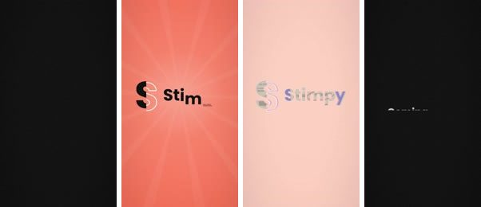</a> | `2026-11-02_2030_reel_logo.mp4` | Something's about to change 👀 في شي عم يتحضّر، خلّيك قريب. | Follow |
| Tue Nov 3 | 12:30 PM | Story | <a href="posts/2026-11-03_1230_story_soon.mp4">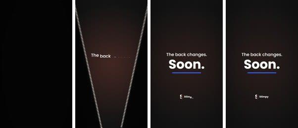</a> | `2026-11-03_1230_story_soon.mp4` | The back changes. بس شو يعني؟ 🤔 | Poll: What changes? |
| Wed Nov 4 | 8:30 PM | Reel | <a href="posts/2026-11-04_2030_reel_question.mp4">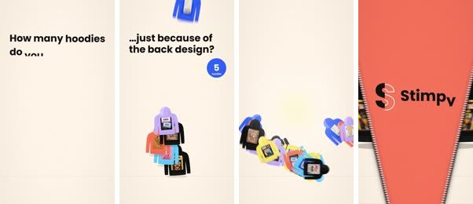</a> | `2026-11-04_2030_reel_question.mp4` | الخزانة مليانة هوديز، وبعد ما عندك شي تلبسو؟ 🫠 We've all been there. | Comment your number |
| Thu Nov 5 | 9:00 PM | Story | <a href="posts/2026-11-05_2100_story_soundfirst.mp4">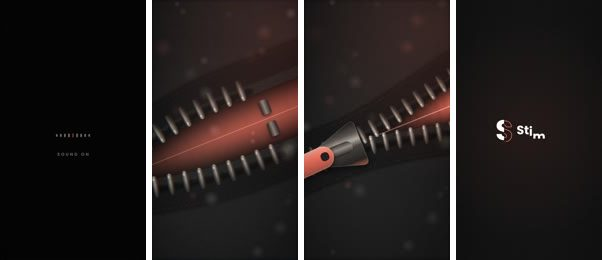</a> | `2026-11-05_2100_story_soundfirst.mp4` | Sound on 🔊 سمعت هالصوت؟ | Poll: What's this? |
| Fri Nov 6 | 8:30 PM | Reel | <a href="posts/2026-11-06_2030_reel_glimpse-bubblegum.mp4">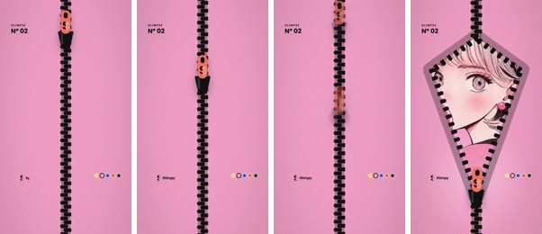</a> | `2026-11-06_2030_reel_glimpse-bubblegum.mp4` | Not yet 🫣 بس اعترف، لحقت تشوفها؟ | Follow |
| Sat Nov 7 | 12:30 PM | Story | <a href="posts/2026-11-07_1230_story_glimpse-sabotage.mp4">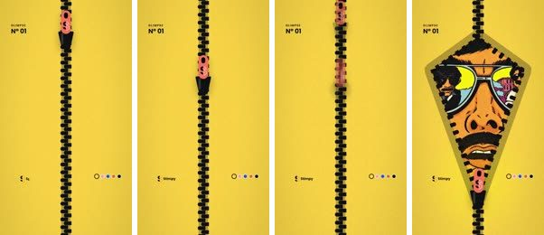</a> | `2026-11-07_1230_story_glimpse-sabotage.mp4` | Not yet 😎 هيدي صوتها عالي. | Poll: Loud or soft? |
| Sat Nov 7 | 8:30 PM | Reel | <a href="posts/2026-11-07_2030_reel_shyback.mp4">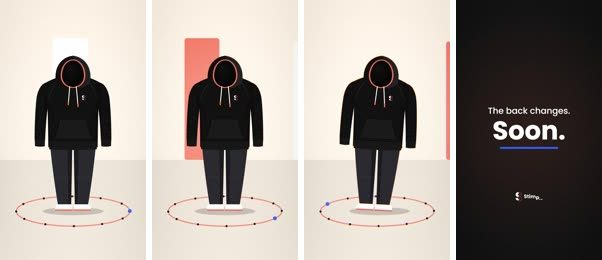</a> | `2026-11-07_2030_reel_shyback.mp4` | هالهودي ما بيعطي ضهرو لحدا... لسّا 🫣 Shy for now. | Send to a friend |
| Sun Nov 8 | 8:30 PM | Reel | <a href="posts/2026-11-08_2030_reel_edgezip.mp4">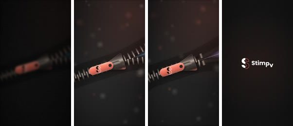</a> | `2026-11-08_2030_reel_edgezip.mp4` | What's this zip for? 🤨 Wrong answers only. أغرب جواب بياخد احترامنا 😌 | Comment |
| Mon Nov 9 | 12:30 PM | Story | <a href="posts/2026-11-09_1230_story_countdown-5.mp4">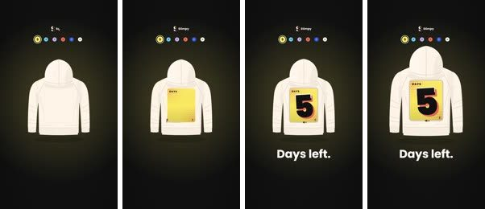</a> | `2026-11-09_1230_story_countdown-5.mp4` | 5 أيام ⏳ | Countdown sticker |
| Mon Nov 9 | 8:30 PM | Reel | <a href="posts/2026-11-09_2030_reel_glimpse-tiger.mp4">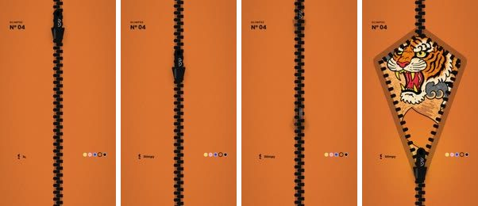</a> | `2026-11-09_2030_reel_glimpse-tiger.mp4` | Pause it if you can 🐯 يلا نشوف سرعة إيدك. | Follow |
| Tue Nov 10 | 12:30 PM | Story | <a href="posts/2026-11-10_1230_story_countdown-4.mp4">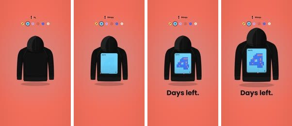</a> | `2026-11-10_1230_story_countdown-4.mp4` | 4 أيام 👀 | Countdown sticker |
| Tue Nov 10 | 8:30 PM | Reel | <a href="posts/2026-11-10_2030_reel_emptyframe.mp4">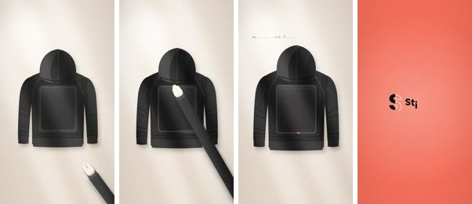</a> | `2026-11-10_2030_reel_emptyframe.mp4` | Something goes here 👀 شو بتتوقّع؟ احزر بالكومنتات. | Comment a guess |
| Wed Nov 11 | 12:30 PM | Story | <a href="posts/2026-11-11_1230_story_countdown-3.mp4">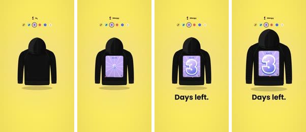</a> | `2026-11-11_1230_story_countdown-3.mp4` | 3 أيام، قرّبنا 🔥 | Countdown sticker |
| Wed Nov 11 | 8:30 PM | Reel | <a href="posts/2026-11-11_2030_reel_stimpy-4.mp4"></a> | `2026-11-11_2030_reel_stimpy-4.mp4` (STIMPY 4, as is) | Zip off. Zip on. New style. 🤯 نازلين 14.11. | Follow |
| Wed Nov 11 | 9:00 PM | Story | <a href="posts/2026-11-11_2100_story_reveal.mp4">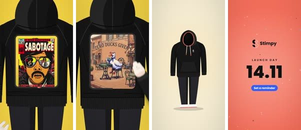</a> | `2026-11-11_2100_story_reveal.mp4` | One hoodie. Multiple identities. 🔥 14.11، حطّها بالكالندر. | Countdown sticker |
| Thu Nov 12 | 12:30 PM | Story | <a href="posts/2026-11-12_1230_story_countdown-2.mp4">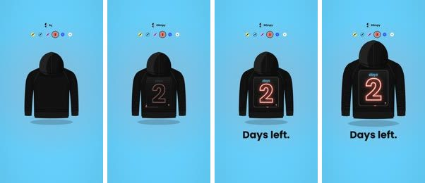</a> | `2026-11-12_1230_story_countdown-2.mp4` | يومين بس 👀 | Countdown sticker |
| Thu Nov 12 | 8:30 PM | Reel | <a href="posts/2026-11-12_2030_reel_arabic-video-2.mp4"></a> | `2026-11-12_2030_reel_arabic-video-2.mp4` (STIMPY 1, founder story) | ليش كل ما بدك تغيّر ستايلك، لازم تشتري قطعة جديدة؟ 🤷 Don't follow the style. Choose your own. | Follow |
| Fri Nov 13 | 12:30 PM | Story | <a href="posts/2026-11-13_1230_story_tomorrow.mp4">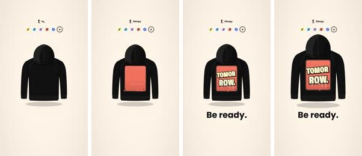</a> | `2026-11-13_1230_story_tomorrow.mp4` | Tomorrow. بكرا! جاهز؟ 🔥 | Countdown sticker |
| Fri Nov 13 | 8:30 PM | Reel | <a href="posts/2026-11-13_2030_reel_50s-film.mp4">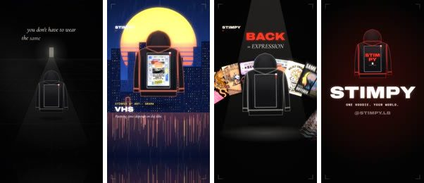</a> | `2026-11-13_2030_reel_50s-film.mp4` | You don't have to wear the same version of yourself every day. ✨ بكرا منبلّش. | Follow |
| Fri Nov 13 | 9:00 PM | Story | <a href="posts/2026-11-13_2100_story_date.mp4">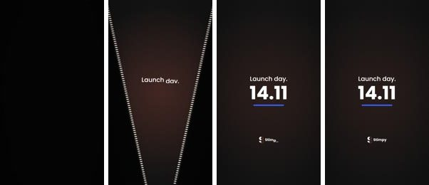</a> | `2026-11-13_2100_story_date.mp4` | 14.11. بكرا الضهر، خلّيك جاهز ⏰ | Countdown sticker |

### Launch, November 14-27

Bio: `One hoodie. Multiple identities. Swap the back, change the look. Order below 👇` Add website and WhatsApp links.

| Date | Time | Format | Preview | File | Caption | CTA |
|---|---|---|---|---|---|---|
| Sat Nov 14 | 12:00 PM | Story | <a href="posts/2026-11-14_1200_story_launch.mp4">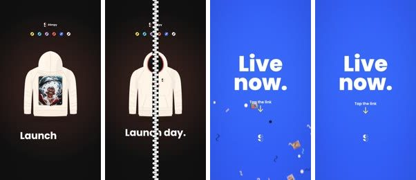</a> | `2026-11-14_1200_story_launch.mp4` | Live now! 🎉 يلا، دوس عالرابط. | Website link sticker |
| Sat Nov 14 | 12:30 PM | Reel, pin | <a href="posts/2026-11-14_1230_reel_stimpy-3.mp4"></a> | `2026-11-14_1230_reel_stimpy-3.mp4` (STIMPY 3, as is) | مين قال إنو الهودي إلو ستايل واحد؟ 😏 Zip off. Zip on. New style. اختار تنين Stimpies من الموقع. الرابط بالـbio. الدفع عند الاستلام. | Website, link in bio |
| Sat Nov 14 | 8:30 PM | Carousel, pin | <a href="posts/2026-11-14_2030_carousel_how-to-order"></a> | `2026-11-14_2030_carousel_how-to-order\` | أسهل من إنك تقرّر شو بدك تلبس اليوم 😌 اختار مقاسك، واختار تنين Stimpies، واطلب من الموقع أو عالواتساب. الدفع عند الاستلام. | WhatsApp, link in bio |
| Sun Nov 15 | 8:30 PM | Post | <a href="posts/2026-11-15_2030_post_one-hoodie.png">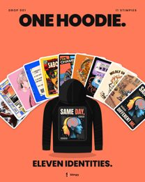</a> | `2026-11-15_2030_post_one-hoodie.png` | One hoodie. Eleven Stimpies to choose from. 🤝 أي تنين بتختار؟ قول بالكومنتات. | Website, link in bio |
| Mon Nov 16 | 8:30 PM | Post | <a href="posts/2026-11-16_2030_post_the-split.png">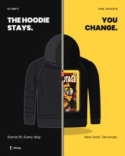</a> | `2026-11-16_2030_post_the-split.png` | The hoodie stays. You change. 😌 ابعتها لصاحبك اللي ما بيغيّر الهودي تبعو. | Send to a friend |
| Tue Nov 17 | 8:30 PM | Reel, pin | <a href="posts/2026-11-17_2030_reel_arabic-video-3.mp4"></a> | `2026-11-17_2030_reel_arabic-video-3.mp4` (STIMPY 2, quality and fit) | الـdesign بيلفت النظر، بس التفاصيل هي اللي بتخلّيك تضلّ تلبسه. 🧵 More than a design. It's all in the details. مش متأكد من المقاس؟ ابعتلنا عالواتساب، الرابط بالـbio. | WhatsApp: ask about size |
| Thu Nov 19 | 8:30 PM | Reel | <a href="posts/2026-11-19_2030_reel_split.mp4">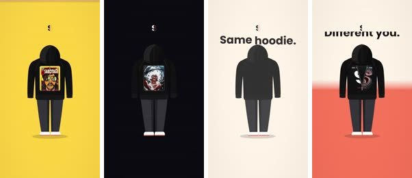</a> | `2026-11-19_2030_reel_split.mp4` | Same hoodie. Different you. 🎭 اليوم مين بدك تكون؟ | Follow |
| Sat Nov 21 | 8:30 PM | Reel | <a href="posts/2026-11-21_2030_reel_glimpse-receipt.mp4">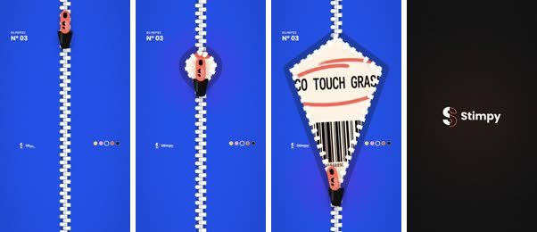</a> | `2026-11-21_2030_reel_glimpse-receipt.mp4` | Total due: go touch grass 🧾🌱 هودي واحد، وظهر بيتغيّر. اختار تنين Stimpies من الموقع. | Website, link in bio |
| Sun Nov 22 | 8:30 PM | Carousel | <a href="posts/2026-11-22_2030_carousel_loud-and-wild">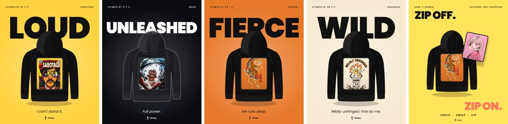</a> | `2026-11-22_2030_carousel_loud-and-wild\` | Loud or wild? 🔊🐯 أي واحد إلك؟ احكيلنا بالكومنتات. | Comment |
| Mon Nov 23 | 12:30 PM | Story | <a href="posts/2026-11-23_1230_story_perfectloop.mp4">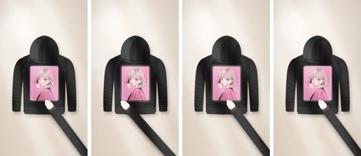</a> | `2026-11-23_1230_story_perfectloop.mp4` | Zip off. Zip on. 🔁 صعب توقّف تتفرّج. | Website link sticker |
| Tue Nov 24 | 8:30 PM | Reel | <a href="posts/2026-11-24_2030_reel_60s-film.mp4">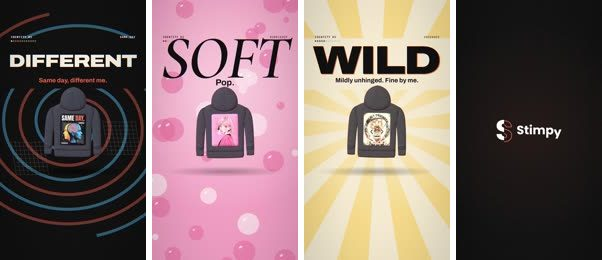</a> | `2026-11-24_2030_reel_60s-film.mp4` | أنت مين اليوم؟ | Comment your design |
| Thu Nov 26 | 8:30 PM | Carousel | <a href="posts/2026-11-26_2030_carousel_soft-and-chill">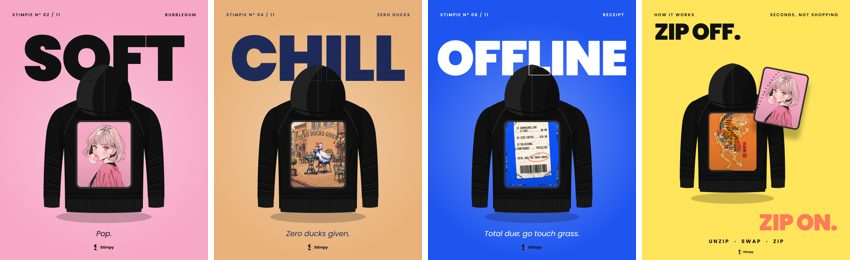</a> | `2026-11-26_2030_carousel_soft-and-chill\` | Soft, chill, offline. 🫧 شو مزاجك اليوم؟ | Website, link in bio |
| Fri Nov 27 | 8:30 PM | Reel | *To film or add* | **Arabic Video 5 (order or customer clip)**<br>Save as `2026-11-27_2030_reel_arabic-video-5.mp4`. If nothing is genuine, use a real product demo or skip | من الطلب للباب 📦 اطلب عالواتساب، الرابط بالـbio. | WhatsApp, link in bio |

### Second phase, November 28-December 3

| Date | Time | Format | Preview | File | Caption | CTA |
|---|---|---|---|---|---|---|
| Sat Nov 28 | 8:30 PM | Reel | <a href="posts/2026-11-28_2030_reel_glimpse-sameday.mp4">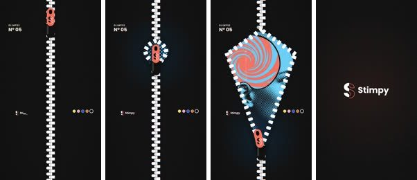</a> | `2026-11-28_2030_reel_glimpse-sameday.mp4` | Same day, different me. 🌀 الصبح شخص، بالليل شخص تاني، والهودي نفسو. | Website, link in bio |
| Tue Dec 1 | 8:30 PM | Carousel | <a href="posts/2026-12-01_2030_carousel_who-are-you-today">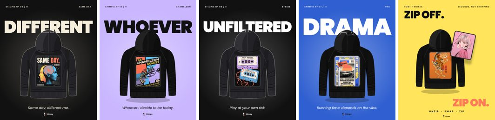</a> | `2026-12-01_2030_carousel_who-are-you-today\` | Who are you today? 🎭 عنّا ظهر لكل مزاج. | Follow |
| Wed Dec 2 | 12:30 PM | Story | <a href="file:///C%3A/Projects/motion/content/posters/stimpy_post_13_which-one-are-you.png">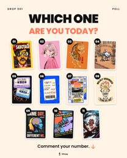</a> | `C:\Projects\motion\content\posters\stimpy_post_13_which-one-are-you.png` | Which one are you today? 👇 جاوبنا. | Question sticker |
| Thu Dec 3 | 8:30 PM | Reel | *To choose Dec 2* | Best-performing ad video, reposted as is | Zip off. Zip on. New style. 🔁 مرة وحدة مش كفاية. الرابط بالـbio. | Website, link in bio |

## Stories to post by hand

Use this if Business Suite can't add the sticker. Captions are in the calendar above. Website links use the organic link tracking above.

| Done | Date | Time | File | Sticker |
|---|---|---|---|---|
| [ ] | Tue Nov 3 | 12:30 PM | `2026-11-03_1230_story_soon.mp4` | Poll: What changes? |
| [ ] | Thu Nov 5 | 9:00 PM | `2026-11-05_2100_story_soundfirst.mp4` | Poll: What's this? |
| [ ] | Sat Nov 7 | 12:30 PM | `2026-11-07_1230_story_glimpse-sabotage.mp4` | Poll: Loud or soft? |
| [ ] | Mon Nov 9 | 12:30 PM | `2026-11-09_1230_story_countdown-5.mp4` | Countdown to Nov 14, 12:00 PM |
| [ ] | Tue Nov 10 | 12:30 PM | `2026-11-10_1230_story_countdown-4.mp4` | Countdown to Nov 14, 12:00 PM |
| [ ] | Wed Nov 11 | 12:30 PM | `2026-11-11_1230_story_countdown-3.mp4` | Countdown to Nov 14, 12:00 PM |
| [ ] | Wed Nov 11 | 9:00 PM | `2026-11-11_2100_story_reveal.mp4` | Countdown to Nov 14, 12:00 PM |
| [ ] | Thu Nov 12 | 12:30 PM | `2026-11-12_1230_story_countdown-2.mp4` | Countdown to Nov 14, 12:00 PM |
| [ ] | Fri Nov 13 | 12:30 PM | `2026-11-13_1230_story_tomorrow.mp4` | Countdown to Nov 14, 12:00 PM |
| [ ] | Fri Nov 13 | 9:00 PM | `2026-11-13_2100_story_date.mp4` | Countdown to Nov 14, 12:00 PM |
| [ ] | Sat Nov 14 | 12:00 PM | `2026-11-14_1200_story_launch.mp4` | Website link |
| [ ] | Mon Nov 23 | 12:30 PM | `2026-11-23_1230_story_perfectloop.mp4` | Website link |
| [ ] | Wed Dec 2 | 12:30 PM | `C:\Projects\motion\content\posters\stimpy_post_13_which-one-are-you.png` | Question: Which one are you today? |

## Carousel slides

Post the slides in filename order.

| Carousel | Slides |
|---|---|
| `2026-11-14_2030_carousel_how-to-order\` | Hook, Size, Stimpies, Order, Cash on delivery. Don't post `contact-sheet.png` |
| `2026-11-22_2030_carousel_loud-and-wild\` | SABOTAGE, NEON, IREZUMI, UNHINGED, The Swap |
| `2026-11-26_2030_carousel_soft-and-chill\` | BUBBLEGUM, ZERO DUCKS, RECEIPT, The Swap |
| `2026-12-01_2030_carousel_who-are-you-today\` | SAME DAY, CHAMELEON, B-SIDE, VHS, The Swap |

## Fixes needed

The replacement exports are now in `posts\`, and the originals are in `_archive\replaced-originals\`. Copies of the five exports also remain in `_archive\fixed-exports\`.

| File | Status |
|---|---|
| `2026-11-13_2030_reel_50s-film.mp4` | Replaced and checked Nov 8: decodes in full, 40s, -14.0 LUFS, -2.5 dBTP. Frames every second show a zip around the panel instead of studs, no edition text, "11 STIMPIES" and the "ONE HOODIE. YOUR WORLD. @STIMPY.LB" end card. Ready to post |
| `2026-11-19_2030_reel_split.mp4` | Replaced. Owner watched it and confirmed all its designs are on the website. Checked Nov 8: 12s, -14.1 LUFS, -1.1 dBTP. Ready to post |
| `2026-11-21_2030_reel_glimpse-receipt.mp4` | Replaced. Checked Nov 8: 15s, -14.1 LUFS, -1.6 dBTP |
| `2026-11-24_2030_reel_60s-film.mp4` | Replaced. Checked Nov 8: 21s, -14.0 LUFS, -2.7 dBTP. The 13-17s titles are a fast transition, with each new panel arriving about 0.25s before its title, so `_CHECK-PLAYBACK` was removed from the name. Ready to post |
| `2026-11-28_2030_reel_glimpse-sameday.mp4` | Replaced. Checked Nov 8: 15s, -14.1 LUFS, -1.5 dBTP |

All five were decoded start to finish with no errors. Audio was measured, not listened to.

Covers still needed: the Nov 11, 12, 14 and 17 Reels and Arabic Video 5. Covers for Nov 21 and Nov 28 are in `_covers\`.

## Files still to add

| File or note | Needed by |
|---|---|
| Arabic Video 5 (order or customer clip), organic only. If nothing is genuine, use a real product demo or skip | Nov 26, suggested |
| Dec 3 Reel: repost the best-performing ad video as is (no re-cut) | Dec 2 |

**Five-video rule (Nov 11):** the five filmed videos in `C:\Users\User\Downloads\stimpy vid\` are the only ad creatives, uploaded as they are. The Reels on Nov 11 (STIMPY 4) and Nov 14 (STIMPY 3) are unchanged copies of those files. Arabic Video 2 (STIMPY 1) and Arabic Video 3 (STIMPY 2) in `posts\` have the audio level adjusted to about -14 LUFS for organic posting; the picture is unchanged. Upload the original files, not these copies, for the ads.
