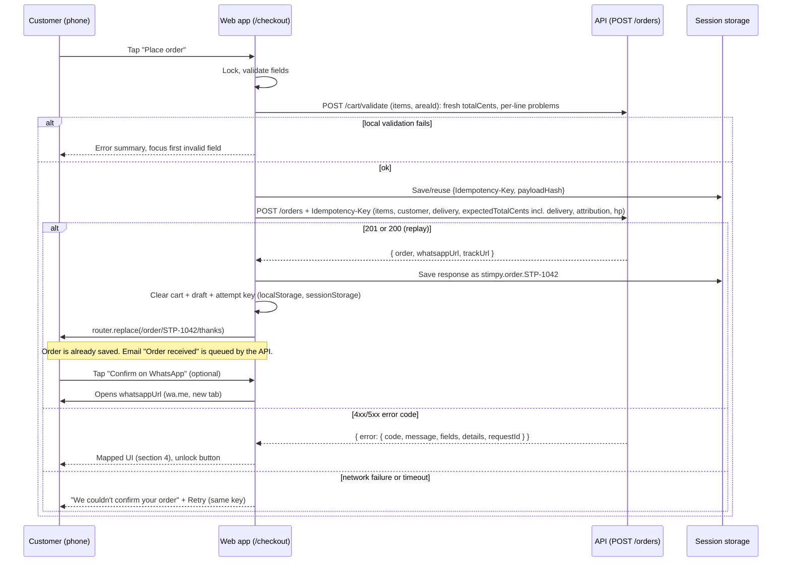

# Checkout and Order Flow (Website)

## Purpose and audience

This document specifies the complete customer purchase flow of the public Stimpy website (`apps/web`): cart, checkout, order confirmation, order tracking, the "Lost your order number?" flow, and UTM handling. It is written for the developer who builds those screens. Every endpoint, field, enum and error code is taken from the API contract, [api-reference.md](../backend/api-reference.md), which wins in any disagreement. Page-by-page layout for the rest of the site is in [website-pages.md](website-pages.md).

Fixed decisions: the cart is client-side only (no account, no server cart) and persisted in `localStorage`; the server validates and prices everything when the order is placed; payment is cash on delivery; currency is USD, shown as `$45` (the API speaks integer cents); English only; mobile-first; customers have no accounts and look orders up by order number + phone.

## Table of contents

1. [Cart](#1-cart)
2. [Checkout page](#2-checkout-page)
3. [Submit sequence](#3-submit-sequence)
4. [POST /orders error handling](#4-post-orders-error-handling)
5. [Confirmation page](#5-confirmation-page)
6. [Tracking page flow](#6-tracking-page-flow)
7. [Order number vs delivery number](#7-order-number-vs-delivery-number)
8. [Analytics and UTM handling](#8-analytics-and-utm-handling)
9. [QA checklist](#9-qa-checklist)
10. [Open questions for the API](#10-open-questions-for-the-api)

---

## 1. Cart

### 1.1 Data model

The cart stores the API's `CartItem` (exactly the shapes in the contract) plus UI-only fields used to render the cart without extra requests. Only the `item` part is ever sent to the API.

```ts
type CartLine = {
  lineId: string;                 // crypto.randomUUID(); UI key only
  item: CartItem;                 // EXACT contract shape, the only part sent to POST /orders
  ui: {
    title: string;                // "Hoodie + 2 Stimpies", "Stimpie: Neon Koi"
    imageUrl: string | null;
    hoodieSlug: string | null;    // used for "pick another size" links (GET /products/hoodies/:slug); not needed for validation
    packSlug: string | null;
    colorName: string | null; colorHex: string | null; sizeLabel: string | null;
    stimpies: { id: number; slug: string; name: string; artworkUrl: string; type: 'CORE' | 'LIMITED' }[];
    unitPriceCents: number;       // client ESTIMATE, from the catalog when added or last re-validated
    addedAt: string;              // ISO date
  };
  check: { state: 'OK' | 'PRICE_CHANGED' | 'ADJUSTED' | 'UNAVAILABLE'; reasons: string[]; checkedAt: string | null };
};
```

Rules that must hold:

| Rule | Detail |
|---|---|
| `pack` line | `item.stimpieIds.length` must equal the pack's `stimpieCount`. `qty` multiplies the whole pack (qty 2 = two hoodies, each with the same Stimpies). |
| `qty` | Integer 1..10 for every kind (contract). The stepper disables at 1 and 10; at 1, the minus button becomes "Remove". |
| Merging | Adding a line identical to an existing one (same kind, ids, colour, size, and the same set of `stimpieIds`) increments `qty` (capped at 10) instead of creating a new line. |
| Duplicate Stimpies inside one pack | **Not allowed** (a pack is N different designs). The pack picker disables a Stimpie already chosen for that pack, and `stimpieIds` is de-duplicated before it is stored. The server enforces the same rule with a `VALIDATION_ERROR` on `items.N.stimpieIds.M` (4.3). The same Stimpie may still appear in several different lines (for example a pack plus an extra); stock is summed. `LIMITED` Stimpies may be used in packs while their drop is live. |
| Lines per order | At most 20 lines (contract). At 20, "Add to cart" shows "Your cart is full. Check out first, or remove a line." |
| Total quantity of a LOW Stimpie | When `Stimpie.remaining` is known (status `LOW`), the UI must not let the sum of that Stimpie across all lines (pack picks + extras) exceed `remaining`. |
| Prices | `ui.unitPriceCents` is never sent. The estimate comes from `Pack.priceCents` (pack), `HoodieSummary.priceCents` (hoodie only), `Stimpie.priceCents` (extra Stimpie). |

### 1.2 Persistence: `localStorage`

| Key | Content | Notes |
|---|---|---|
| `stimpy.cart` | `{ v: 1, updatedAt, lines: CartLine[] }` | The cart. Written on every change (debounce 100 ms). |
| `stimpy.checkout.draft` | `{ v: 1, customer, delivery }` | Form values to survive refresh. Never stores the honeypot. Cleared on successful order. |
| `stimpy.utm` | see [section 8](#8-analytics-and-utm-handling) | Session attribution (actually `sessionStorage`). |

`sessionStorage` keys: `stimpy.checkout.attempt` (idempotency key, see 2.6) and `stimpy.order.<number>` (confirmation handoff, see 5.2).

Versioning and safety:

- Every stored object has a numeric `v`. On load, run migrations `v -> v+1` in order. An unknown higher `v` (user downgraded) or unparseable JSON must reset the cart to empty without throwing, and show no error.
- Every read and write is wrapped in `try/catch` (private mode, quota, blocked storage). If storage is unavailable the cart still works in memory for the page lifetime, and a one-time notice says "Your cart won't be saved if you close this tab."
- Lines older than 30 days (`updatedAt`) are discarded on load with a toast "Your cart was cleared because it was old." Younger carts are kept and re-validated (1.6).
- Multi-tab: listen to the `storage` event and reload cart state, so two tabs never overwrite each other with stale data. Last write wins.
- The cart context is a client-side store (React context + reducer). Server components never read the cart.

### 1.3 Composing a pack (hoodie colour/size, then N Stimpies)

Entry points: Hoodie detail, Builder, Home packs, `PackCard`. All use the same `PackComposer` component.

1. **Pick a pack** from `GET /packs` (e.g. "Hoodie + 2 Stimpies" `stimpieCount: 2`, "Hoodie + 1 Stimpie"), or "Hoodie only" (`kind: 'hoodie'`, price from `HoodieSummary.priceCents`).
2. **Pick hoodie colour and size** from `GET /products/hoodies/:slug` (`colors`, `sizes`, `variants`). A size is disabled when the matching `variants[].inStock` is `false` for the chosen colour; when `remaining` is not null show "Only {n} left". Colour with no in-stock variant is shown crossed out.
3. **Pick exactly N Stimpies** (N = `stimpieCount`) from `GET /products/stimpies`. Only `purchasable: true` ones are selectable; others stay visible with their badge (Sold out, Coming soon). A progress label reads "Pick 2 Stimpies (1/2)". "Add to cart" stays disabled until the count is exact.
4. **Add to cart** creates `{ kind: 'pack', packId, hoodieId, colorId, sizeId, stimpieIds, qty: 1 }` and opens the cart drawer.

Extra Stimpies: any Stimpie card/detail has "Add to cart" creating `{ kind: 'stimpie', stimpieId, qty: 1 }` (compatible with any hoodie). Extras are separate lines and show the price from `Stimpie.priceCents`.

If the customer changes the pack's Stimpies later, they remove the line and re-compose (the drawer's "Edit" re-opens `PackComposer` pre-filled and replaces the line on save).

### 1.4 Price display: estimate vs server truth

| Where | What is shown | Source |
|---|---|---|
| Product cards, detail | Price per item | Catalog, `formatCents(priceCents)` -> `$45`, `$45.50` only if not whole dollars |
| Cart drawer | Subtotal = sum of `unitPriceCents x qty`; "Delivery calculated at checkout"; estimate text | Client estimate; `estimateText` from `GET /delivery/fees` |
| Checkout | Subtotal + delivery fee + total | Client estimate, delivery fee from `GET /delivery/fees` for the chosen area |
| Confirmation, tracking | Final amounts | **Server truth**: `order.subtotalCents`, `deliveryFeeCents`, `totalCents` |

The client estimate is only a preview and is labelled "Estimated total" until the order is placed. The client sends `expectedTotalCents` so the server can reject a stale price with `PRICE_CHANGED`; the confirmation page always shows the server's numbers.

`expectedTotalCents` is the **grand total including the delivery fee** (items plus delivery; contract example: $55.00 + $3.00 = `5800`). The value to send is the `totalCents` returned by the pre-submit `POST /cart/validate` call (1.6) for the chosen `areaId`, which is exactly what the customer sees as the total. If that call could not complete (network), send the displayed total (`subtotal + fee`) or omit the field; it is optional, and the server prices the order either way. The old `expectedTotalForApi()` workaround is gone.

### 1.5 Cart drawer behaviour

- Opens from the header cart icon and automatically after every successful add. Slides in from the right; full width on phones (minus a 24 px peek of the page), 420 px on desktop.
- Contents top to bottom: header ("Your cart", count, close), line list (thumbnail, title, colour/size, Stimpie names, `QuantityStepper`, line total, Remove), validation notices (from `POST /cart/validate`, 1.6), subtotal, delivery note, "Checkout" button (electric blue, full width, sticky at the bottom), "Continue shopping" link.
- Empty state: "Your cart is empty." with buttons to Shop and the Builder.
- Accessibility: `role="dialog"`, `aria-modal="true"`, labelled by its heading, focus moves to the heading on open and returns to the cart icon on close, focus is trapped, Esc and backdrop tap close it, body scroll is locked while open. Count changes announce through a polite live region ("Added Hoodie + 2 Stimpies. Cart has 1 item.").
- "Checkout" is disabled while any line is `UNAVAILABLE`, with the reason shown. It links to `/checkout`.
- The drawer is also closed automatically on navigation.

### 1.6 Re-validation (stock or availability changed since the item was added)

The client re-validates the whole cart with the public endpoint `POST /cart/validate`. It reads the same `items` array as `POST /orders` plus an optional `areaId`, reserves nothing, and reports "can't buy it right now" per line (never as an HTTP error). It is rate limited like the catalog.

**When it is called**

1. When the cart drawer opens (skipped if the last successful check is under 30 s old).
2. When `/checkout` mounts, and again whenever the customer changes a quantity, removes a line or picks a different area (debounced 500 ms), so the shown totals stay exact.
3. Immediately before submit, always, with the chosen `areaId`. Its `totalCents` is the value sent as `expectedTotalCents` (1.4). If it reports any line not ok, the submit is stopped and the cart notices are shown instead.
4. After a `SOLD_OUT`, `NOT_PURCHASABLE` or `PRICE_CHANGED` response, or a `VALIDATION_ERROR` on an `items.N...` path (4.3).

**Request:** `{ items: <every cart line's item, in cart order, UNAVAILABLE lines included so indices match>, areaId? }`. Use `fetch(..., { cache: 'no-store' })`.

**Response mapping.** `lines[].itemIndex` is the position in the submitted `items`, i.e. the cart line at that index.

| Response | Result on the line |
|---|---|
| `line.ok: true` | `OK`. If `line.unitPriceCents` differs from `ui.unitPriceCents`: `PRICE_CHANGED`, new price stored, notice "The price of {title} changed to {price}." |
| Problem with `reason: 'INACTIVE'` | `UNAVAILABLE`: "{name} isn't available any more." |
| Problem with `reason: 'DROP_NOT_STARTED'` | `UNAVAILABLE`: "{name} isn't on sale yet. The drop hasn't started." |
| Problem with `reason: 'DROP_ENDED'` | `UNAVAILABLE`: "{name}: this drop has ended." |
| Stock problem (`requested`, `available`), `kind: 'HOODIE_VARIANT'`, `available` is 0 | `UNAVAILABLE`: "{colour}, {size} just sold out." with a link to pick another size (uses `ui.hoodieSlug`) |
| Stock problem, `kind: 'STIMPIE'`, `available` is 0 | `UNAVAILABLE`: "{name} just sold out." |
| Stock problem with `0 < available < requested` | `ADJUSTED`: the line at `itemIndex` has its `qty` lowered by `requested - available` (if that leaves less than 1, it becomes `UNAVAILABLE`); toast "Only {available} left, we updated your cart." Then re-run validate once, because another line may still need the same thing (stock is summed across lines) |
| `400 VALIDATION_ERROR` on `items.N...` (unknown or removed product, wrong `stimpieIds` count) | Line N: `UNAVAILABLE`, "This item isn't sold any more." |
| Network failure, timeout or `429` | Keep the previous state, skip the notice; the server's response at submit is the authority |

`subtotalCents` (of the lines that are ok), `deliveryFeeCents`, `totalCents` and `estimateText` from the response feed the drawer subtotal and the checkout summary in place of the client estimate.

Behaviour: unavailable lines stay in the cart, greyed and struck through, with "Remove" and "Find a replacement" (opens the picker for pack lines, or the Shop for extras). They are excluded from the subtotal. Checkout cannot be submitted while the response has `ok: false` or any line is `UNAVAILABLE`.

---

## 2. Checkout page

Route `/checkout`. Client-only (`noindex`). One page, no account. Loads `GET /delivery/fees` (client, on mount) and runs cart validation with `POST /cart/validate` (1.6).

Empty cart: show "Your cart is empty" with Shop and Builder buttons (and, if a recent order exists in this tab, a link to its confirmation).

### 2.1 Layout

Mobile, top to bottom: page heading, collapsible **Order summary** (open by default, shows lines with editable `QuantityStepper`, remove, estimated totals), **Your details**, **Delivery**, **Payment** (static text), consent line, sticky bottom bar with the total and **Place order**. Desktop: two columns, form left, sticky summary right.

### 2.2 Fields

All text inputs are 16 px or larger (prevents iOS zoom), minimum height 48 px, label always visible above the input, `name` attribute equal to the contract path.

| Field (label) | Contract path | Input | `autocomplete` | Client validation (server is the authority) | Error copy |
|---|---|---|---|---|---|
| Full name | `customer.name` | `text`, `maxlength="80"` | `name` | Required, trimmed, 2 to 80 characters | "Enter your full name." |
| Email | `customer.email` | `email`, `inputmode="email"`, `maxlength="190"` | `email` | Required, basic email shape, at most 190 characters | "Enter a valid email address." |
| Phone | `customer.phone` | `tel`, `inputmode="tel"`, placeholder `03 123 456` | `tel` | Required; after removing spaces, dashes and a leading `+961`/`00961`/`0`, 7 or 8 digits remain | "Enter a Lebanese phone number, like 03 123 456." |
| "WhatsApp is the same as my phone number" | `customer.whatsappSameAsPhone` | checkbox, checked by default | `off` | none | none |
| WhatsApp number | `customer.whatsapp` | `tel`, `inputmode="tel"` | `tel` | Shown only when the checkbox is unticked; required then; same rule as phone | "Enter your WhatsApp number." |
| Area | `delivery.areaId` + `delivery.areaName` | `select` of areas from `GET /delivery/fees` plus "Other (type it below)" | `address-level2` | Required | "Choose your area." |
| Area (other) | `delivery.areaName` | `text`, `maxlength="120"`, shown only for "Other" | `address-level2` | Required then, at most 120 characters | "Type your area or town." |
| Address | `delivery.address` | `textarea`, 3 rows, `maxlength="300"` | `street-address` | Required, trimmed, 5 to 300 characters | "Enter your delivery address: street, building, floor." |
| Notes (optional) | `delivery.notes` | `textarea`, 2 rows, `maxlength="300"` | `off` | at most 300 characters | none |

Length limits come from the contract's conventions table; show a "{n}/300" counter on address and notes once they pass 80% of the limit. The server normalises phone and WhatsApp to `+961XXXXXXXX`; the client sends them as typed.
| (hidden) | `hp` | `text`, see 2.5 | `off` | none | none |

Static text near the fields: the consent line under the contact fields, "We'll email you updates about this order and may contact you on WhatsApp about it." Under Payment: "Cash on delivery. You pay in cash when your order arrives. No card needed."

Validation timing: validate a field on blur, then live on change once it has been touched. On submit, validate everything, put an error summary (`role="alert"`, links to each field) above the form, and move focus to the first invalid field. Messages are specific and plain; never "Invalid input".

### 2.3 "WhatsApp same as phone" behaviour

- Checked (default): the WhatsApp input is hidden and a hint reads "We'll use {phone as typed} on WhatsApp." The request sends `whatsapp: null, whatsappSameAsPhone: true`.
- Unchecked: the WhatsApp input appears pre-filled with the current phone value so the customer only edits it. The request sends `whatsapp: "<typed>", whatsappSameAsPhone: false`.
- Re-checking the box hides the field again and discards the typed WhatsApp value.
- Focus moves to the new input when unchecked. The checkbox state is saved in the draft.

### 2.4 Area, delivery fee and total

- Data: `GET /delivery/fees` -> `{ defaultFeeCents, areas[{ id, name, feeCents|null, estDays|null }], estimateText }`.
- Fee for a selected area = `area.feeCents ?? defaultFeeCents`. For "Other" send no `areaId` and use `defaultFeeCents`.
- Before an area is chosen show "Delivery: from {defaultFee}" (not a final number) and the total as "Estimated total".
- After choosing: show "Delivery to {area}: {fee}" and the estimate (`estDays` as "about {n} days" when not null, otherwise `estimateText`), and update the total immediately: `total = subtotal + fee`.
- If the fees request fails: show "We couldn't load delivery areas" with Retry; fall back to a free-text area field (no `areaId`) so the customer is never blocked, with the fee line reading "Delivery fee confirmed on WhatsApp" (the server still prices the order).
- The displayed total (items plus delivery) is the grand total sent as `expectedTotalCents`; the authoritative figure is the `totalCents` of the pre-submit `POST /cart/validate` call (1.4, 1.6). In the fallback with no `areaId`, the server uses the default fee, and `cart/validate` reports that same total.
- The delivery estimate shown at checkout is `estimateText` from `POST /cart/validate` (or the `estDays` rule above). The order response's `estimateText` is authoritative afterwards.

### 2.5 Honeypot `hp`

A text input named `hp`, `tabindex="-1"`, `autocomplete="off"`, `aria-hidden="true"`, wrapped in a container positioned off-screen with CSS (not `display:none`, which some bots detect), with a label of "Leave this empty" for the rare assistive-tech tool that still reads it. The client always sends `"hp": ""` taken from the field's current value (so a bot filling it is rejected by the server with a generic `VALIDATION_ERROR`). Browser autofill must not fill it: use a non-obvious `name` attribute in the DOM (e.g. `website_url`) mapped to `hp` in the payload. If the server returns a `VALIDATION_ERROR` with no `fields` (the honeypot case), show the generic message "Something went wrong. Please try again." and never reveal the reason.

### 2.6 Idempotency key and double-submit prevention

Idempotency key rules (header `Idempotency-Key: <uuid>`):

1. Generate with `crypto.randomUUID()` on the first submit attempt and store `{ key, payloadHash }` in `sessionStorage` (`stimpy.checkout.attempt`). `payloadHash` is a hash of the exact request body.
2. **Reuse** the same key when retrying the same payload (network failure, timeout, 5xx, tab refresh, `RATE_LIMITED`). A replay returns `200` with the original order instead of `201`; treat `200` and `201` identically.
3. **Generate a new key** whenever the payload changes (any field, any cart line, `expectedTotalCents`, `attribution`, or a fix after `SOLD_OUT`/`PRICE_CHANGED`/`VALIDATION_ERROR`). The server enforces this: the same key with a different body is rejected with `409 CONFLICT` (`details.field = "Idempotency-Key"`; see 4.1). The client compares `payloadHash` before every send and rotates the key itself, so the 409 should never be seen in normal use.
4. Delete the stored key after a successful response.

Double-submit prevention (all required):

- A synchronous `useRef` lock set in the click/submit handler before any `await`, so two taps in the same frame cannot both pass; plus `isSubmitting` state that disables the button and sets `aria-busy`.
- Button label changes to "Placing order..." with a spinner. Enter key presses in fields while submitting are ignored.
- While in flight, warn on tab close/refresh (`beforeunload`), and keep inputs read-only.
- After 8 s show "Still working. Please don't close this page." After a 30 s client timeout (`AbortController`) treat it as a network failure (4.2).
- Even if the lock is bypassed, the idempotency key makes the second request return the same order.

---

## 3. Submit sequence



Key facts for the developer:

- **The order exists the moment `POST /orders` returns.** The WhatsApp message is a convenience; if the customer never sends it, the order is still in the dashboard as `NEW`, and the founder can message them. The confirmation page says this plainly ("Your order is placed. Sending the WhatsApp message helps us confirm it faster.").
- The site must **not** auto-open WhatsApp (popup blockers and mobile app switching would hide the confirmation). The confirmation page shows a prominent one-tap **Confirm on WhatsApp** button instead.
- `whatsappUrl` can be `null` (business number not configured). Then the button is hidden and the text says "We'll message you on WhatsApp to confirm."
- The cart is cleared only after a success response, never before.

---

## 4. POST /orders error handling

All errors use the contract format `{ error: { code, message, fields, details, requestId } }`. Switch on `code`, never on `message`. `message` is safe to show to a customer and is used as the default text where a row below says "server message".

**Support line.** Every generic "Something went wrong" message (honeypot, 5xx, unexpected 4xx, network failure after the response arrived) ends with a small line "If it keeps happening, message us and quote this code: {requestId}" with a copy button. `requestId` comes from `error.requestId` (or the `X-Request-Id` response header, which the browser can read because the API exposes it). When there is no response at all (offline, timeout) there is no id and the line is omitted.

### 4.1 Per-code responses

| HTTP / `code` | UI response |
|---|---|
| 400 `VALIDATION_ERROR` with `fields` | Unlock the form, set each field's error from `fields[path]` (mapping in 4.3), show the error summary, focus the first invalid field. Keep the draft. Generate a new idempotency key on the next attempt if the payload changes. |
| 400 `VALIDATION_ERROR` without `fields` (honeypot or unknown field) | Generic banner "Something went wrong. Please try again." plus the `requestId` support line. No field marked. |
| 409 `SOLD_OUT` | Nothing was reserved. Open the **Sold out** dialog (4.4), map `details.items` to cart lines by `itemIndex` and update them, then call `POST /cart/validate` to confirm. The customer returns to checkout with the cart corrected. |
| 409 `NOT_PURCHASABLE` | Dialog "Some items can't be ordered right now". Each `details.items[]` entry has `itemIndex` (the cart line, because the cart is sent in cart order), `name` and `reason`: `INACTIVE` -> "{name} isn't available any more."; `DROP_NOT_STARTED` -> "{name} isn't on sale yet. The drop hasn't started."; `DROP_ENDED` -> "{name}: this drop has ended." Mark those lines `UNAVAILABLE`, offer Remove and "Find a replacement", then call `POST /cart/validate`. |
| 409 `CONFLICT` with `details.field = "Idempotency-Key"` | The key was reused with a different body. Discard the stored key, generate a new one, and resend once automatically. Any other `CONFLICT` field: generic banner with the support line. |
| 422 `PRICE_CHANGED` | Dialog "The price changed": show the old total and the new `details.totalCents` (the new grand total including delivery, formatted), plus the message "Review your order and confirm." Update the displayed totals by calling `POST /cart/validate`, do **not** auto-resubmit. Button becomes "Place order for {newTotal}"; the next submit uses the new total as `expectedTotalCents` and a new idempotency key. |
| 429 `RATE_LIMITED` | Banner "You're doing that too fast. Try again in {n} seconds." where `n` is `details.retryAfterSeconds` (the `Retry-After` header carries the same number). Disable the button with a live countdown, then re-enable it. The same idempotency key may be reused (nothing was created). |
| 500 `INTERNAL` or any 5xx | Treat like a network failure (4.2): the outcome is unknown, retry with the same key. Show the server message if present, else "Something went wrong on our side." plus the `requestId` support line. |
| Network failure, timeout, offline | See 4.2. |
| 401/403 (not expected on public routes) | Generic "Something went wrong. Please try again." with the `requestId` support line, and log it. |

### 4.2 Network failure and safe retry

The outcome of a request that failed in transit is **unknown**: the order may or may not exist. Therefore:

1. Show a blocking-but-calm panel: "We couldn't confirm your order. Your cart is safe. Tap Retry. You won't be charged twice and we won't create a duplicate."
2. **Retry** resends the identical payload with the **same** `Idempotency-Key`. If the first request actually succeeded, the API returns the original order with `200`; go to the confirmation page as normal.
3. Offer a second path: "Already got an email from us? Then your order went through. Track it with your phone number" -> `/track`.
4. Detect `navigator.onLine === false` before sending: show "You're offline" and keep the button enabled for when the connection returns (listen to the `online` event to clear the message).
5. Never clear the cart or draft in any failure path.

### 4.3 `VALIDATION_ERROR` field mapping

| `fields` key | UI target |
|---|---|
| `customer.name` | Full name |
| `customer.email` | Email |
| `customer.phone` | Phone |
| `customer.whatsapp` | WhatsApp number (if hidden because "same as phone" is checked, reveal it by unticking the box) |
| `delivery.areaId` / `delivery.areaName` | Area select (or the "Other" text input) |
| `delivery.address` | Address |
| `delivery.notes` | Notes |
| `items.<n>.stimpieIds.<m>` (duplicate Stimpie in a pack) | Cart notice on line `n`: "A pack needs different Stimpies. Change the repeated one." with Edit (re-opens `PackComposer`). The UI already prevents this (1.1), so it only appears for a stale or hand-edited cart |
| `items.<n>.*` (e.g. `items.0.sizeId`) | Not a form field: open the cart notice for line `n` ("Please check this item") and call `POST /cart/validate`. Line index = position in the submitted `items` array, which is the cart order |
| `items` (array as a whole, e.g. more than 20 lines) | Cart-level banner with the server message; the cart cannot exceed 20 lines (1.1) |
| `expectedTotalCents` | Treat like `PRICE_CHANGED` (call `POST /cart/validate`, refresh totals) |
| `attribution.*` | Drop the `attribution` object (never block an order over tracking data), generate a new key and resend once |
| `hp` or an unknown key | Generic banner, no field |

The text shown for a field is `fields[path]` (the server's plain-English message, e.g. "Enter a valid email address."), falling back to the client copy in 2.2 if empty.

### 4.4 `SOLD_OUT` with alternatives

`details.items[]` is a list of `StockProblem`: `{ kind: 'HOODIE_VARIANT', hoodieId, colorId, sizeId } | { kind: 'STIMPIE', stimpieId }`, plus `itemIndex` (position in the submitted `items`, i.e. the cart line that first needs it), `name`, `requested` (total units the whole order needs) and `available` (units still orderable). When several things fail, all are listed in one response.

1. Heading: "Sorry, {name} just sold out." (for several items: "A few items just sold out." with a list). Subtext: "Nothing was charged and nothing was reserved."
2. Update the cart directly from the response; no catalog re-validation is needed to find the line. The line is `cart.lines[itemIndex]`; `kind` and the ids confirm what ran out (a hoodie variant, or a Stimpie that may be inside a pack or an extra line). If `available > 0`, lower that line's `qty` by `requested - available` (say "Only {available} left"); if that leaves less than 1, or `available` is `0`, mark the line `UNAVAILABLE`. Then call `POST /cart/validate` once to catch other lines that share the same shortage and to refresh totals.
3. **Alternatives**, loaded fresh with `GET /products/stimpies?includeSoldOut=false`:
   - Sold-out Stimpie: show up to 4 purchasable Stimpies, same `type` first, as `StimpieCard`s with a "Swap in" button (replaces the Stimpie in the pack, or adds an extra line).
   - Sold-out hoodie size/colour: reload `GET /products/hoodies/:slug` and show the other in-stock sizes/colours with a "Switch" button.
   - Nothing else available: a "Notify me" link for the drop (`POST /drops/:id/subscribe`) if the Stimpie belongs to a drop, and a link to the Shop.
4. Buttons: "Update my order" (closes the dialog, returns to checkout) and "Back to shop". The dialog is focus-trapped and announces its heading.

---

## 5. Confirmation page

Route `/order/[number]/thanks`. Client-only (`noindex`), because it reads session state.

### 5.1 What it shows

| Element | Source |
|---|---|
| Heading "Order placed" and the order number large (e.g. `STP-1042`) with a **Copy** button | `order.number` |
| Line "Keep this number: it's how you refer back to your order." | static |
| Items (name, qty, line total, hoodie/colour/size, Stimpie names) | `order.items` (`OrderItem[]`) |
| Subtotal, delivery fee, total, "Pay cash at the door" | `order.subtotalCents`, `deliveryFeeCents`, `totalCents` |
| Delivery estimate | `order.estimateText` (authoritative: `"<N> working days"` when the chosen area has `estDays`, otherwise the global text; never recompute it on the client) |
| **Confirm on WhatsApp** button (electric blue) | `whatsappUrl`, opens in a new tab (`target="_blank" rel="noopener"`). Hidden when `null` |
| Next steps (3 short bullets): we'll message you, delivery estimate, pay at the door | static + `estimateText` |
| Email notice | "We're sending a confirmation to {order.contactEmail}." plus "Wrong email? Contact us" linking to WhatsApp (`business.whatsappNumber`) or `mailto:` (`business.supportEmail`) from `GET /content` |
| "Track your order" link | `trackUrl` (use the path, `/track?order=STP-1042`) |
| Continue shopping link | static |

Copy button: uses `navigator.clipboard.writeText`, falls back to selecting the text; shows "Copied" for 2 s with `aria-live="polite"`. The order number is plain selectable text too.

### 5.2 Where the data comes from

The API has no public read endpoint for a placed order (only `POST /orders/track`, which needs the phone); this is confirmed in the contract and in [open-questions.md](../open-questions.md). So:

1. **Normal path:** on success, checkout writes the full `POST /orders` response to `sessionStorage` as `stimpy.order.<number>` and navigates with `router.replace('/order/<number>/thanks')`. The page reads that key.
2. **Refresh in the same tab:** `sessionStorage` survives, so the page renders fully again.
3. **Opened directly, in another tab/device, or after the session ended** (no stored data): show a reduced view: the order number from the URL (validated against `/^[A-Za-z0-9-]{3,20}$/`, otherwise show 404), the message "We can't show the full details here. Track your order with your phone number.", a **Track this order** button to `/track?order=<number>`, and the WhatsApp contact button using `business.whatsappNumber`. Never show items or personal data in this mode.
4. **Back button after placing:** `router.replace` means Back leaves checkout out of history. If the customer lands on `/checkout` again with an empty cart, they see the empty state with a link to the recent order.

### 5.3 States

| State | Behaviour |
|---|---|
| Loading | Skeleton for 1 frame only (storage read is synchronous) |
| Full data | As in 5.1 |
| No stored data | Reduced view (5.2.3) |
| `whatsappUrl` null | No WhatsApp button, text "We'll message you on WhatsApp to confirm." |
| Clipboard blocked | Copy button shows "Press and hold to copy"; text stays selectable |

---

## 6. Tracking page flow

Route `/track`. Static shell with client-side form; `noindex`.

### 6.1 Form

| Field | Input | Accepted formats | Notes |
|---|---|---|---|
| Order number | `text`, `autocapitalize="characters"`, `autocomplete="off"`, `autocorrect="off"` | `STP-1042`, `stp-1042`, `1042` (contract: bare number and any letter case) | Trim; send as typed. Pre-filled from `?order=` (this is how `trackUrl` and the email link land here) or from the most recent order in `sessionStorage`. |
| Phone | `tel`, `inputmode="tel"`, `autocomplete="tel"` | `03 123 456`, `03123456`, `+961 3 123 456`, `00961 3 123 456` | Same light client check as checkout (2.2). Server normalizes and compares. |

Button: **Track order** (electric blue). Submit calls `POST /orders/track` with `{ orderNumber, phone }`. Lock the button while loading.

Errors:

| Case | UI |
|---|---|
| Client validation | "Enter your order number." / "Enter the phone number you ordered with." |
| 404 `NOT_FOUND` (unknown order **or** wrong phone, deliberately identical) | "We couldn't find an order with those details. Check the order number and use the phone number you ordered with." Never say which one was wrong. Keep both fields filled. |
| 400 `VALIDATION_ERROR` | Per-field from `fields` |
| 429 `RATE_LIMITED` | "Too many tries. Please wait {retryAfterSeconds} seconds." and disable the button until then |
| Network / 5xx | "Couldn't reach the server. Try again." with Retry |

### 6.2 Result view

Response fields: `number`, `status`, `placedAt`, `customerName`, `items`, `subtotalCents`, `deliveryFeeCents`, `totalCents`, `deliveryNumber`, `timeline`, `estimateText`, `whatsappNumber`.

- Heading "Hi {customerName}, here's order {number}". Placed date formatted from `placedAt` in the device locale.
- **StatusTimeline** with the five steps: Received (`NEW`), Confirmed (`CONFIRMED`), Packed (`PACKED`), Out for delivery (`OUT_FOR_DELIVERY`), Delivered (`DELIVERED`). A step is "done" when its status appears in `timeline` (show its time), "current" for the latest status, "upcoming" otherwise. If `status` is `CANCELLED` or `RETURNED`, stop the line at the last reached step and show a banner ("This order was cancelled." / "This order was returned.") with a WhatsApp contact button; later steps are hidden.
- **Delivery number rule:** show a "Delivery number" card only when `deliveryNumber` is not `null` (the API sends it only from `OUT_FOR_DELIVERY` onward). Text: "Your parcel is with delivery. Quote this number if the courier calls." with a copy button. When `null`, show no card and no placeholder, and never mention a delivery number before dispatch.
- Items list, subtotal, delivery fee, total ("Pay cash at the door" until `DELIVERED`, then "Paid on delivery" is not shown because payment is not tracked publicly).
- Estimate (`estimateText`) while status is before `DELIVERED`.
- **Contact on WhatsApp** button from `whatsappNumber` (`https://wa.me/<digits>`); hidden when `null`.
- "Track another order" link resets the form. The result view is not cached or stored beyond component state.

### 6.3 "Lost your order number?"

- A text link under the form expands an inline form (single field): **Email** (`type="email"`, `autocomplete="email"`).
- Submit calls `POST /orders/find` with `{ email }`. On any `202` show exactly the response `message` ("If we found orders for this email, we've emailed you the order numbers.") in a success style, regardless of whether orders exist. The UI must not branch, animate, or time differently based on the result.
- Do not pre-validate beyond email shape; do not say "no orders found". `429 RATE_LIMITED` shows "Too many tries. Please wait {retryAfterSeconds} seconds." (this reveals nothing about the email). Network failure shows a retry message.
- After success, collapse the form and focus the message (`role="status"`).

---

## 7. Order number vs delivery number

| | Order number | Delivery number |
|---|---|---|
| Example | `STP-1042` | `D-88231` |
| Shown on | Confirmation page (large, copy button), every email, the WhatsApp message, tracking page as the lookup key | Tracking page only, once `deliveryNumber` is not `null`; also in the "On its way" email (sent by the API) |
| Customer action | Keep it; enter it on `/track` with the phone | Quote it to the courier or when contacting Stimpy |
| Label copy | "Order number" | "Delivery number" |
| Visual treatment | Black on cream, monospace-like tabular numerals, copy button | A separate card under the timeline, sky background, black text |

The two must never share a label, colour or position, and the UI must never imply they are interchangeable. Copy that mentions the order number says "the order number we gave you"; copy that mentions the delivery number says "the number from the delivery slip". The tracking input accepts only order numbers.

---

## 8. Analytics and UTM handling

- **Capture:** on first client render of any page (root layout client effect), read `utm_source`, `utm_medium`, `utm_campaign`, `utm_content`, `utm_term` from the URL. If at least one is present, write `{ utm_*: ..., landingPath, referrer: document.referrer, capturedAt }` to `sessionStorage` key `stimpy.utm`, replacing any older value (latest campaign touch wins). If none are present and the key exists, leave it untouched.
- **Keep for the session:** the values live in `sessionStorage` for the tab session. They are not removed from the URL, and they are carried across client-side navigation automatically because storage, not the URL, holds them. Strip control characters and cap each stored value at 100 characters.
- **Sent to the API as `attribution`.** `POST /orders` accepts the optional object `attribution: { utmSource, utmMedium, utmCampaign }`, stored on the order and shown to the founder in Insights ("by campaign"); it is never shown to customers. Build it at submit time from `stimpy.utm`: `utm_source` -> `utmSource`, `utm_medium` -> `utmMedium`, `utm_campaign` -> `utmCampaign`. Each value must be at most 80 characters and contain only letters, digits and `-_.`, so before sending, trim to 80 and remove any other character; omit a key whose value ends up empty, and omit the whole `attribution` object when no key remains (send `null` for nothing). `utm_content`, `utm_term`, `landingPath` and `referrer` stay local (the contract rejects unknown fields). Attribution must never block an order: if the server answers a `VALIDATION_ERROR` on `attribution.*`, resend once without it (4.3).
- **Event hook:** all tracking goes through one `track(event, props)` function that is a no-op until an analytics provider is chosen. Events: `view_item`, `add_to_cart`, `begin_checkout`, `purchase` (with `order.number` and `totalCents`), `track_order`. Props may include the stored UTM values. No personal data (name, email, phone, address) may ever be passed to `track`.
- Instagram bio links should always carry UTM parameters (see the plan section 12.2); the site must function identically with or without them.

---

## 9. QA checklist

Run on a real phone over the local network (`http://<pc-ip>:3000`) plus desktop. "Pass" means the stated result and no console errors.

**Cart**
- [ ] 1. Add a pack with 2 Stimpies: cart shows one line with the pack price; reload the page, the cart persists.
- [ ] 2. Add the identical pack again: quantity becomes 2, not a second line; at quantity 10 the plus button is disabled.
- [ ] 3. Pack "Add to cart" stays disabled until exactly N Stimpies are picked; a sold-out Stimpie is visible but not selectable.
- [ ] 4. Add an extra Stimpie as a separate line; remove it with the minus button at quantity 1.
- [ ] 5. Corrupt `stimpy.cart` in DevTools (invalid JSON): app loads with an empty cart and no error screen.
- [ ] 6. Set `stimpy.cart.updatedAt` to 31 days ago: cart is cleared with a toast; at 10 days old it is kept and re-validated.
- [ ] 7. Open the site in two tabs and add items in one: the other tab's cart updates.
- [ ] 8. Disable storage (private mode): cart works in memory and the one-time notice appears.

**Stale cart / availability**
- [ ] 9. Sell out a Stimpie in the dashboard after adding it: opening the drawer marks the line unavailable and disables Checkout.
- [ ] 10. End a drop (or set status `ENDED`) with a Stimpie from it in the cart: line shows "isn't available right now".
- [ ] 11. Change a price in the dashboard: drawer shows "price changed" notice with the new subtotal.
- [ ] 12. A `LOW` Stimpie with `remaining` 1 and quantity 2 in the cart: quantity is lowered to 1 with a toast.
- [ ] 13. Deactivate a hoodie size/colour in the dashboard: the line becomes unavailable with a "pick another size" link.

**Checkout form**
- [ ] 14. Submit empty: error summary appears, focus goes to the first invalid field, each field shows its message.
- [ ] 15. Phone `03 123 456`, `03123456` and `+961 3 123 456` all pass client validation; `123` fails.
- [ ] 16. "Same as phone" checked: request has `whatsapp: null, whatsappSameAsPhone: true`; unchecked shows a pre-filled WhatsApp field and sends the typed value.
- [ ] 17. Choosing an area with its own fee and one without (default fee) updates the delivery line and total immediately; "Other" uses the default fee and sends no `areaId`.
- [ ] 18. Honeypot: fill `hp` through DevTools: the request is rejected with a generic message and no field is flagged; normal use always sends `"hp": ""`.
- [ ] 19. Reload mid-form: the draft (without notes secrets or honeypot) is restored.

**Submit, failures, retries**
- [ ] 20. Happy path: order placed, lands on `/order/STP-xxxx/thanks`, cart and draft are cleared, the order shows as `NEW` in the dashboard.
- [ ] 21. Double-tap "Place order" quickly (and press Enter twice): exactly one order exists.
- [ ] 22. Throttle to "Slow 3G": button shows "Placing order...", after 8 s the "still working" note appears, and the order completes once.
- [ ] 23. Go offline just before submit: "You're offline" message; back online, submit works.
- [ ] 24. Block the response (kill the API after the request is accepted, or use DevTools to drop the response): after Retry, the same `Idempotency-Key` is sent and exactly one order exists.
- [ ] 25. Change a field after a failure, then retry: a new idempotency key is sent.
- [ ] 26. Sell out a Stimpie in another browser, then submit: `SOLD_OUT` dialog shows the item, alternatives, cart is corrected, nothing was reserved (stock unchanged).
- [ ] 27. Submit with an item whose drop has not started: `NOT_PURCHASABLE` dialog with the "isn't on sale yet" copy.
- [ ] 28. Change a price between page load and submit with `expectedTotalCents` sent: `PRICE_CHANGED` dialog shows the new total; the next submit succeeds only after confirming.
- [ ] 29. Exceed the rate limit with repeated submits: `RATE_LIMITED` banner counts down `retryAfterSeconds` and re-enables the button.
- [ ] 30. Server returns a `VALIDATION_ERROR` for `customer.email` (e.g. via a value the client allowed): the message appears under Email and focus moves there.
- [ ] 31. Fail `GET /delivery/fees` (stop the API before opening checkout): fallback free-text area appears and the order can still be placed.

**Navigation**
- [ ] 32. After success, press Back: the checkout form is not shown with a filled cart; empty-cart state appears with a link to the order.
- [ ] 33. Refresh the confirmation page: it renders from `sessionStorage` fully.
- [ ] 34. Open the confirmation URL in a new tab/incognito: reduced view with "Track this order", no items or personal data.
- [ ] 35. Tap **Confirm on WhatsApp**: the correct business number opens with the order number and summary pre-filled; closing it leaves the order intact (`NEW` in the dashboard).
- [ ] 36. Order number copy button copies `STP-xxxx`; with clipboard blocked it degrades gracefully.

**Tracking**
- [ ] 37. Track with `STP-1042`, `stp-1042` and `1042` plus the correct phone: all return the same result.
- [ ] 38. Wrong phone and unknown order number produce the identical not-found message.
- [ ] 39. Move the order through statuses in the dashboard: timeline updates; delivery number card appears only from `OUT_FOR_DELIVERY` onward and never before.
- [ ] 40. Cancelled order: banner shown and later steps are hidden.
- [ ] 41. `?order=STP-1042` pre-fills the order number field.
- [ ] 42. "Lost your order number?" with a known email and an unknown email: identical on-screen message and timing behaviour; the known email receives the numbers in Mailpit.
- [ ] 43. Repeated wrong lookups trigger `RATE_LIMITED` with a visible wait.

**UTM / misc**
- [ ] 44. Land with `?utm_source=instagram&utm_medium=story&utm_campaign=drop02`, browse, and check out: `sessionStorage['stimpy.utm']` holds the values, `POST /orders` contains `attribution: { utmSource: "instagram", utmMedium: "story", utmCampaign: "drop02" }` and no other UTM field, and the order appears under "by campaign" in the dashboard Insights. Without any UTM parameters the request has no `attribution` at all.
- [ ] 45. Keyboard only: complete checkout, drawer focus trap and return focus work, error summary links jump to fields.
- [ ] 46. 320 px wide viewport: no horizontal scroll on cart, checkout, confirmation, tracking.

**Added with the completed contract**
- [ ] 47. Idempotency key and a changed cart: submit, let it fail in transit, change the quantity of a line, submit again: a new `Idempotency-Key` is sent and one order exists. Force the same key with a different body (DevTools): the API's `409 CONFLICT` makes the client rotate the key and resend once.
- [ ] 48. Duplicate Stimpie in a pack: the picker will not select the same Stimpie twice. Edit `stimpy.cart` by hand to repeat an id and submit: the `VALIDATION_ERROR` on `items.N.stimpieIds.M` shows the "needs different Stimpies" notice on line N.
- [ ] 49. Sell out a Stimpie in the dashboard, open the drawer: `POST /cart/validate` marks that line unavailable (struck through, Checkout disabled), the subtotal excludes it, and no catalog GETs were needed.
- [ ] 50. Partial stock: a Stimpie with 1 left, qty 2 in the cart: validate reports `available: 1, requested: 2`, the line is lowered to 1 with the toast, and a second validate returns `ok: true`.
- [ ] 51. `expectedTotalCents` includes delivery: with items $55 and delivery $3 the request carries `5800` and the order is accepted; change a price between the pre-submit validate and the order: `PRICE_CHANGED` dialog shows the new grand total.
- [ ] 52. Sell out an item between the pre-submit validate and `POST /orders`: the `SOLD_OUT` dialog updates `cart.lines[itemIndex]` directly (check with a hoodie variant and with a Stimpie inside a pack) and the subsequent validate is `ok: true`.
- [ ] 53. Same Stimpie in two lines (a pack and an extra) with total demand above stock: the response reports one problem with the summed `requested`, and after adjusting, validate no longer flags the other line.
- [ ] 54. Break the API (500) during submit: the message ends with "quote this code: {requestId}" matching the `X-Request-Id` header; offline shows no code.
- [ ] 55. Trigger `429` on submit: the countdown starts from `details.retryAfterSeconds` (equal to `Retry-After`).
- [ ] 56. Enter 81 characters in Full name, 301 in Address: the inputs stop at their `maxlength` (80, 300), and an over-limit value pasted into notes is rejected with the server's message under the field.
- [ ] 57. The confirmation page shows `order.estimateText` exactly as returned: "2-3 working days" for an area with no `estDays`, "{N} working days" for one that has it.

---

## 10. Open questions for the API

The decision log is [../open-questions.md](../open-questions.md); every earlier question from this section (C1-C10) is settled there.

None open; every earlier question is settled in ../open-questions.md
